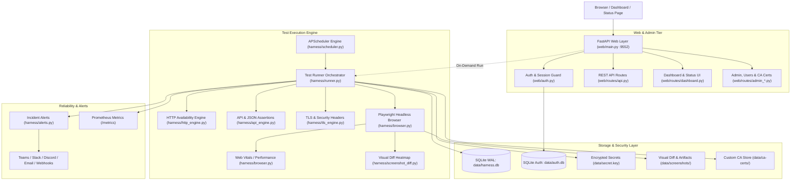

# Web Testing Harness System Overview & Architectural Blueprint

**Web Testing Harness (`testharness`)** is an enterprise-grade, self-hosted synthetic monitoring and automated testing engine. It combines lightweight HTTP endpoint polling, complex multi-step REST/JSON API contract tests with variable chaining, and end-to-end browser journeys via Playwright.

---

## 1. System Architecture



---

## 2. Component Directory Map

```text
testharness/
├── harness/                      # Core test execution engine
│   ├── runner.py                 # Central orchestrator: loads tests, executes engines, persists results
│   ├── http_engine.py            # Fast async HTTP/HTTPS ping & availability checks
│   ├── api_engine.py             # Multi-step REST API tests, JSON schema extraction & step chaining
│   ├── tls_engine.py            # TLS certificate expiration, SAN validation & security headers prober
│   ├── browser.py                # Playwright automation, screenshot captures & Core Web Vitals extraction
│   ├── screenshot_diff.py        # Visual regression pixel diffing & high-contrast heatmap generation
│   ├── proxy.py                  # Outbound forward proxy resolver (HTTP_PROXY / HTTPS_PROXY / config)
│   ├── scheduler.py              # In-process cron scheduling (APScheduler)
│   ├── alerts.py                 # Webhook, Slack, Teams, Discord & email dispatch
│   ├── db.py                     # SQLite interface for runs, results, and test history (WAL mode)
│   ├── auth_db.py                # SQLite store for users, hashed passwords, roles & session tokens
│   ├── secrets.py                # Symmetric Fernet encryption for credentials and auth headers
│   ├── ca_certs.py               # Custom CA certificates and Chromium SPKI pin injection
│   └── models.py                 # Pydantic data schemas for tests, environments, and results
├── web/                          # FastAPI Web UI and REST API
│   ├── main.py                   # App factory, lifespan lifecycle, middleware & static mounts
│   ├── proxy_middleware.py       # ASGI Reverse Proxy middleware (CIDR trusted proxies & headers)
│   ├── routes/                   # Route handlers (dashboard, API, auth, apps, runner, admin, proxy)
│   ├── static/                   # Dark-themed CSS (Inter / JetBrains Mono) & client scripts
│   └── templates/                # Jinja2 HTML templates for dashboard, run logs, and status pages
├── tests/                        # Pytest suite (868+ passing unit & integration tests)
├── deploy/                       # Production observability & alerting assets
│   ├── prometheus/alerts.yml     # Prometheus alerting rules (failure rates, stalls, staleness)
│   └── grafana/dashboard.json    # Complete Grafana operations dashboard model
├── apps/                         # App definition YAMLs (target applications and synthetic steps)
├── data/                         # Local database files, secrets key & screenshots (gitignored)
├── config.yaml                   # Global scheduling, alerting channels & environment definitions
├── docker-compose.yml            # Production container configuration
├── Dockerfile                    # Multi-stage container build (UID 10001 unprivileged)
└── GEMINI.md                     # Root AI developer directives
```

---

## 3. Test Execution Lifecycles

### 3.1 HTTP Availability Check
1. Runner schedules execution via cron or receives on-demand trigger.
2. `http_engine.py` opens `httpx.AsyncClient` with custom timeout and optional TLS verification settings.
3. Evaluates status code, response time, TLS certificate expiration, and substring assertions.
4. Records duration, status (`pass` / `fail`), and error trace to SQLite.
5. If consecutive failures exceed threshold, `alerts.py` dispatches notifications to configured channels.

### 3.2 Multi-Step API Chaining Check
1. Executes sequential HTTP requests (e.g. `POST /login` -> extract `access_token`).
2. Regex / JSONPath extracts variables into ephemeral execution context.
3. Injects variables into downstream headers (`Authorization: Bearer {{access_token}}`) or request JSON bodies.
4. Performs assertions against JSON schemas, response headers, and latency SLOs.

### 3.3 Playwright Browser Journey
1. Spawns isolated Chromium browser context with configured viewport, user agent, and optional custom CA bundle (`--ignore-certificate-errors-spki-list`).
2. Traverses test steps: click, type, wait for selector, evaluate JavaScript.
3. Captures full-page screenshots and compares with baseline images via Pillow diff.
4. Records network logs, console errors, and step execution timings.

### 3.4 TLS Certificate & Security Header Probing
1. Connects directly to target host via SSL socket handshake in `tls_engine.py`.
2. Inspects certificate Subject Alternative Names (SANs) and computes days remaining until expiration (`min_days_valid`).
3. Verifies negotiated protocol version against minimum threshold (`min_tls_version`, e.g. `TLSv1.2` / `TLSv1.3`).
4. Sends HTTPS probe to inspect HTTP security headers (`Strict-Transport-Security`, `X-Content-Type-Options`, `Content-Security-Policy`).
5. Appends structured step log and triggers alerts if certificates are near expiration or headers are absent.

### 3.5 Visual Regression & Baseline Approval Workflow
1. When a browser test step executes `screenshot: null`, `harness/runner.py` captures a candidate screenshot.
2. If `diff_threshold` is configured, it queries the database for the last passing screenshot baseline (`get_last_screenshot` with `status='pass'`).
3. If visual variance exceeds the threshold, `generate_diff_image()` renders a high-contrast magenta (`#FF007F`) heatmap overlay image (`<slug>-diff.png`) and flags the step as failed.
4. Operators review the failure in the web dashboard and can approve intentional UI updates via `POST /api/visual/approve`.
5. Approval sets `status='pass'`, upserts `app_state` to passing, logs an audit entry, and immediately promotes the candidate image to the canonical baseline.

### 3.6 Core Web Vitals & Frontend Performance Monitoring
1. After browser page navigation, `extract_web_vitals()` queries the Navigation Timing API and `PerformanceObserver` paint and layout-shift entries.
2. Captures Time to First Byte (TTFB), First Contentful Paint (FCP), Largest Contentful Paint (LCP), Cumulative Layout Shift (CLS), and DomContentLoaded / Load event timings.
3. Evaluates optional test assertions (`max_lcp_ms`, `max_fcp_ms`, `max_ttfb_ms`, `max_cls`, `max_load_ms`).
4. Records formatted performance summaries directly into test step logs for visualization in the run detail view and dashboard.

### 3.7 Reverse & Outbound Proxy Architecture
1. **Reverse Proxy (Inbound)**: `ReverseProxyMiddleware` parses incoming `X-Forwarded-*` headers, sanitizes client IP based on trusted CIDR masks, dynamically flags secure cookies over HTTPS, and sets `root_path` for subpath deployments. Diagnosed via `/admin/proxy`.
2. **Forward Proxy (Outbound)**: `harness/proxy.py` extracts outbound egress proxies from `config.yaml` or system environment variables (`HTTP_PROXY`, `HTTPS_PROXY`, `NO_PROXY`), transparently forwarding them to Chromium browser launches and HTTP/API client engines.
