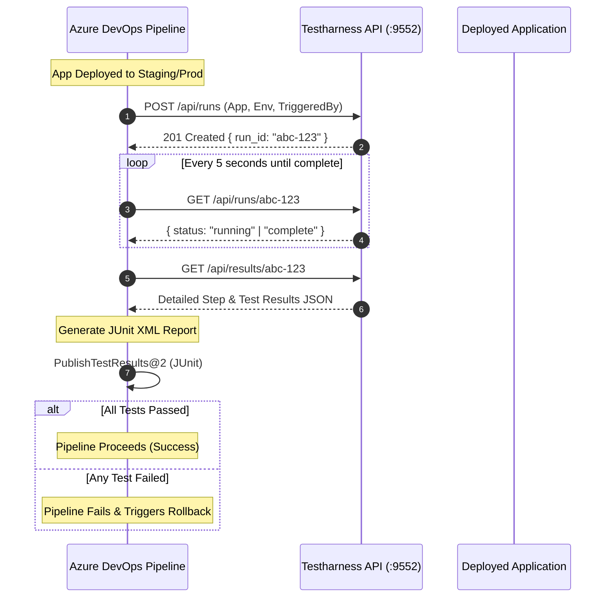

# Integrating with Azure DevOps Pipelines (API Trigger & Quality Gate)

This guide explains how to trigger automated synthetic tests from an **Azure DevOps Pipeline** (YAML or Classic Release) after deploying your application, poll for execution status, and publish rich test results into the Azure DevOps **Tests** dashboard as a deployment quality gate.

---

## 1. Architecture & Workflow



---

## 2. Prerequisites & Credentials

1. **Generate a Testharness API Key**:
   - Log into your Testharness web dashboard (e.g. `https://testharness.example.com` or `http://localhost:9552`).
   - Navigate to **API Keys** &gt; **Create Key** (Name: `Azure-DevOps-CI`, Role: `Runner`).
   - Copy the generated API key (`hth_...`).

2. **Configure Azure DevOps Pipeline Variables**:
   - In Azure DevOps, go to **Pipelines** &gt; **Library** &gt; **+ Variable group** (e.g. named `testharness-credentials`).
   - Add the following variables:
     - `HARNESS_BASE_URL`: `https://testharness.yourcompany.com` (or your internal homelab/VPN URL).
     - `HARNESS_API_KEY`: Secret variable containing `hth_...`.
   - Link the variable group to your pipeline.

---

## 3. Azure DevOps Pipeline YAML (`azure-pipelines.yml`)

The following pipeline script:
- Triggers the synthetic test run for a specific application and environment.
- Polls the run with exponential backoff until completion.
- Downloads the test results JSON and converts it to a standard **JUnit XML** file.
- Publishes the results to Azure DevOps using `PublishTestResults@2` so failure messages, stack traces, and durations appear on the **Tests** tab.

```yaml
trigger: none

parameters:
  - name: environment
    displayName: Target Environment
    type: string
    default: staging
    values:
      - staging
      - production
  - name: appName
    displayName: Application to Test
    type: string
    default: "my-web-app"

variables:
  - group: testharness-credentials

jobs:
  - job: SyntheticMonitoringGate
    displayName: "Testharness Synthetic Gate: ${{ parameters.appName }} (${{ parameters.environment }})"
    pool:
      vmImage: "ubuntu-latest"
    steps:
      - task: UsePythonVersion@0
        displayName: "Set Python 3.x"
        inputs:
          versionSpec: "3.x"

      - bash: |
          set -euo pipefail

          APP="${{ parameters.appName }}"
          ENV="${{ parameters.environment }}"
          BASE_URL="$(HARNESS_BASE_URL)"
          API_KEY="$(HARNESS_API_KEY)"

          echo "##[section]Triggering synthetic test run on $BASE_URL for $APP [$ENV]..."

          # 1. Trigger the run
          RESPONSE=$(curl -fsSL -X POST "$BASE_URL/api/runs" \
            -H "X-API-Key: $API_KEY" \
            -H "Content-Type: application/json" \
            -d "{\"app\": \"$APP\", \"environment\": \"$ENV\", \"triggered_by\": \"azure-devops-pipeline\"}")

          RUN_ID=$(echo "$RESPONSE" | python3 -c "import sys, json; print(json.load(sys.stdin).get('run_id', ''))")

          if [ -z "$RUN_ID" ]; then
            echo "##[error]Failed to retrieve run_id from response: $RESPONSE"
            exit 1
          fi

          echo "Run triggered successfully. Run ID: $RUN_ID"
          echo "Dashboard URL: $BASE_URL/runs/$RUN_ID"

          # 2. Poll until status is 'complete' or 'error'
          MAX_RETRIES=60
          SLEEP_SECONDS=5
          COMPLETED=false

          for ((i=1; i<=MAX_RETRIES; i++)); do
            STATUS_JSON=$(curl -fsSL -H "X-API-Key: $API_KEY" "$BASE_URL/api/runs/$RUN_ID")
            STATUS=$(echo "$STATUS_JSON" | python3 -c "import sys, json; print(json.load(sys.stdin).get('status', ''))")
            
            echo "Checking status ($i/$MAX_RETRIES): $STATUS"

            if [ "$STATUS" = "complete" ] || [ "$STATUS" = "error" ]; then
              COMPLETED=true
              break
            fi

            sleep $SLEEP_SECONDS
          done

          if [ "$COMPLETED" != "true" ]; then
            echo "##[error]Test execution timed out after $((MAX_RETRIES * SLEEP_SECONDS)) seconds"
            exit 1
          fi

          # 3. Retrieve individual test results
          RESULTS_JSON=$(curl -fsSL -H "X-API-Key: $API_KEY" "$BASE_URL/api/results/$RUN_ID")
          echo "$RESULTS_JSON" > results.json

          # 4. Generate JUnit XML report for Azure DevOps
          python3 - << 'EOF'
          import json, xml.etree.ElementTree as ET

          with open("results.json") as f:
              results = json.load(f)

          suite = ET.Element("testsuite", {
              "name": "Testharness Synthetic Suite",
              "tests": str(len(results)),
              "failures": str(sum(1 for r in results if r.get("status") != "pass")),
              "errors": "0",
          })

          all_passed = True
          for r in results:
              test_name = r.get("test_name", "unknown")
              duration = str((r.get("duration_ms") or 0) / 1000.0)
              case = ET.SubElement(suite, "testcase", {
                  "name": test_name,
                  "classname": f"synthetic.{r.get('app', 'app')}",
                  "time": duration,
              })
              if r.get("status") != "pass":
                  all_passed = False
                  err_msg = r.get("error_msg") or "Test failed without explicit error message"
                  failure = ET.SubElement(case, "failure", {
                      "message": err_msg,
                      "type": "SyntheticTestFailure"
                  })
                  failure.text = f"Status: {r.get('status')}\nError: {err_msg}"

          tree = ET.ElementTree(suite)
          tree.write("test-results.xml", encoding="utf-8", xml_declaration=True)
          
          if not all_passed:
              print("##vso[task.logissue type=error]One or more synthetic monitoring tests failed.")
          EOF

        displayName: "Execute Synthetic Tests & Generate JUnit Report"

      - task: PublishTestResults@2
        displayName: "Publish Test Results to Azure DevOps"
        condition: always()
        inputs:
          testResultsFormat: "JUnit"
          testResultsFiles: "test-results.xml"
          testRunTitle: "Synthetic Smoke Tests - ${{ parameters.appName }} (${{ parameters.environment }})"
          failTaskOnFailedTests: true
```

---

## 4. Bulk Run by Tag (Multi-Service Smoke Tests)

If you have a microservices architecture and want to validate **all critical services** at once, you can trigger a bulk run using the `tag` parameter:

```bash
RESPONSE=$(curl -fsSL -X POST "$BASE_URL/api/runs" \
  -H "X-API-Key: $API_KEY" \
  -H "Content-Type: application/json" \
  -d '{"tag": "critical", "environment": "production", "triggered_by": "ado-release-gate"}')

# Response returns a list of run_ids:
# { "run_ids": ["id-1", "id-2", "id-3"], "apps": ["auth-api", "web-portal", "payments"] }
```

In your pipeline script, iterate over the returned `run_ids` array, wait for all to reach `complete`, and merge all test results into the JUnit XML output.

---

## 5. Cross-Platform PowerShell Version

If running on Windows self-hosted Azure DevOps build agents, use the native PowerShell step:

```yaml
- powershell: |
    $app = "${{ parameters.appName }}"
    $env = "${{ parameters.environment }}"
    $headers = @{ "X-API-Key" = "$(HARNESS_API_KEY)" }
    $body = @{ app = $app; environment = $env; triggered_by = "azure-devops" } | ConvertTo-Json

    # 1. Trigger Run
    $res = Invoke-RestMethod -Uri "$(HARNESS_BASE_URL)/api/runs" -Method Post -Headers $headers -Body $body -ContentType "application/json"
    $runId = $res.run_id
    Write-Host "Triggered run: $runId"

    # 2. Poll Status
    do {
      Start-Sleep -Seconds 5
      $run = Invoke-RestMethod -Uri "$(HARNESS_BASE_URL)/api/runs/$runId" -Headers $headers
      Write-Host "Status: $($run.status)"
    } while ($run.status -eq "running" -or $run.status -eq "pending")

    # 3. Retrieve Results
    $results = Invoke-RestMethod -Uri "$(HARNESS_BASE_URL)/api/results/$runId" -Headers $headers
    $failed = $results | Where-Object { $_.status -ne "pass" }

    if ($failed.Count -gt 0) {
      Write-Error "Synthetic test failed: $($failed.test_name -join ', ')"
      exit 1
    }
  displayName: "Execute Synthetic Tests (PowerShell)"
```

---

## 6. Release Gates & Automated Rollback

To use Testharness as an automated deployment gate in **Azure Pipelines Environments**:

1. In Azure DevOps, go to **Pipelines** &gt; **Environments**.
2. Select your environment (e.g. `Production`).
3. Click **Approvals and checks** &gt; **+** &gt; **Invoke REST API**.
4. Configure:
   - **Connection**: Generic Service Connection to `https://testharness.yourcompany.com`
   - **Method**: `POST`
   - **Headers**: `X-API-Key: $(HARNESS_API_KEY)`
   - **Body**: `{"app": "production-api", "environment": "production"}`
   - **Success criteria**: `eq(root['status'], 'complete')`
